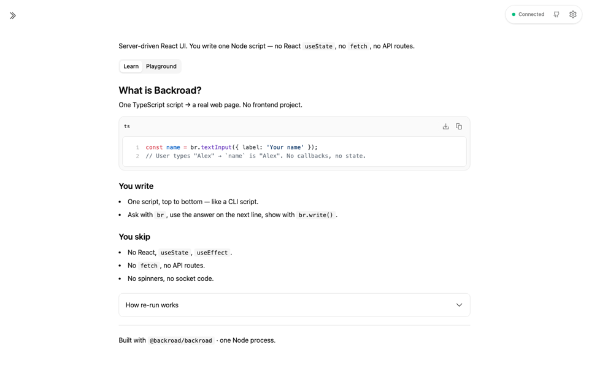
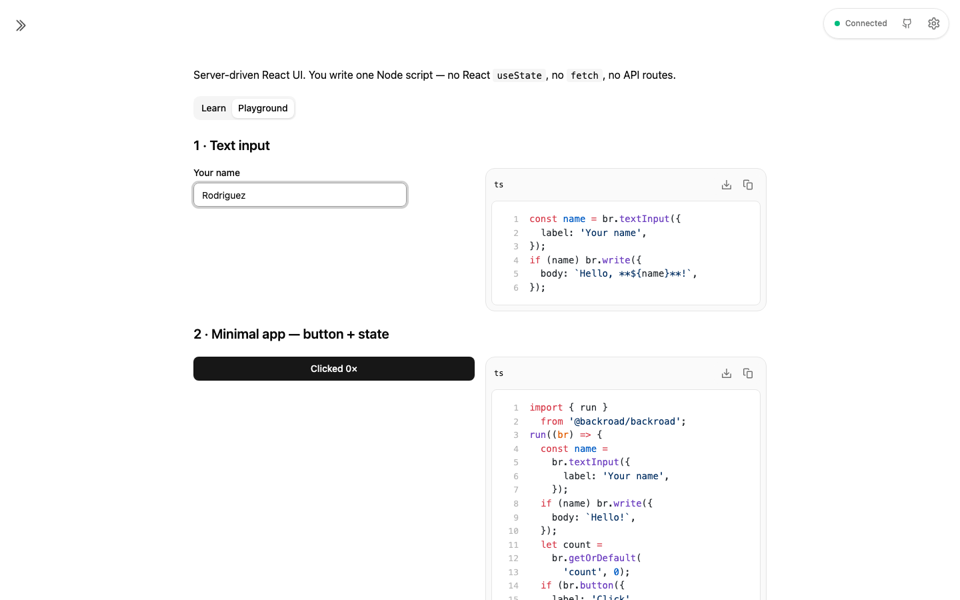
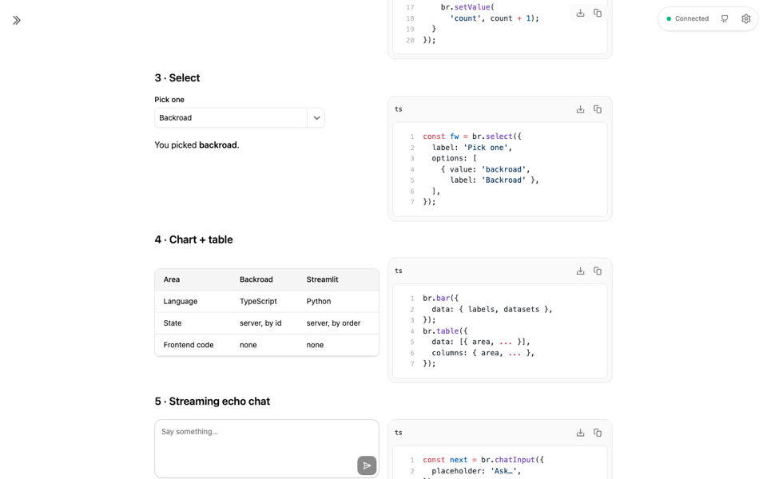
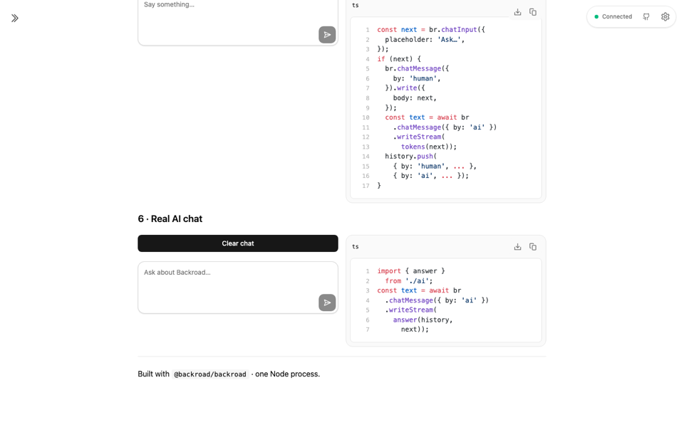

# Backroad Demo with AI

Learn [Backroad](https://backroad.sudomakes.art/docs) by using it. One Node script, no React code, no API routes.

## Run

```bash
nvm use 24
npm install
npm run dev    # http://localhost:3333
```

Optional: copy `.env.example` to `.env`, set `OPENAI_API_KEY` for real AI answers. Without it the chat runs in demo mode.

## What you get

- **Learn** — what Backroad is, the re-run loop, stats.
- **Playground** — 6 live demos, each with code beside it: text input, minimal app, select, chart + table, echo chat, real AI chat.

## Verify

```bash
npm run typecheck  # tsc --noEmit
npm run smoke      # headless client, auto-starts server if needed
npm run exec       # run tabs directly, no server
```

## Screenshots

### Learn tab



### Playground — inputs & minimal app



### Playground — chart + table



### Playground — chats


